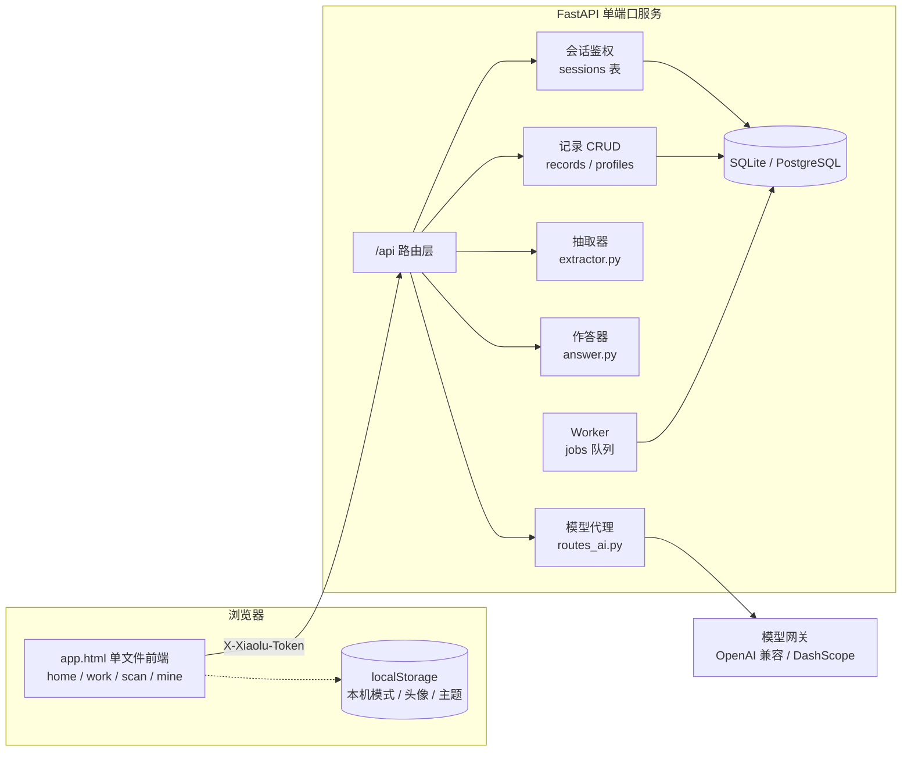
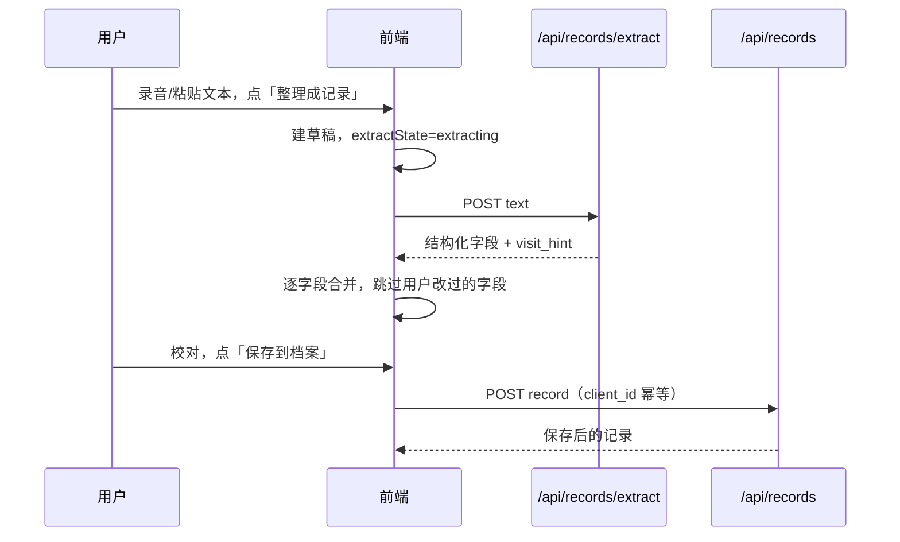
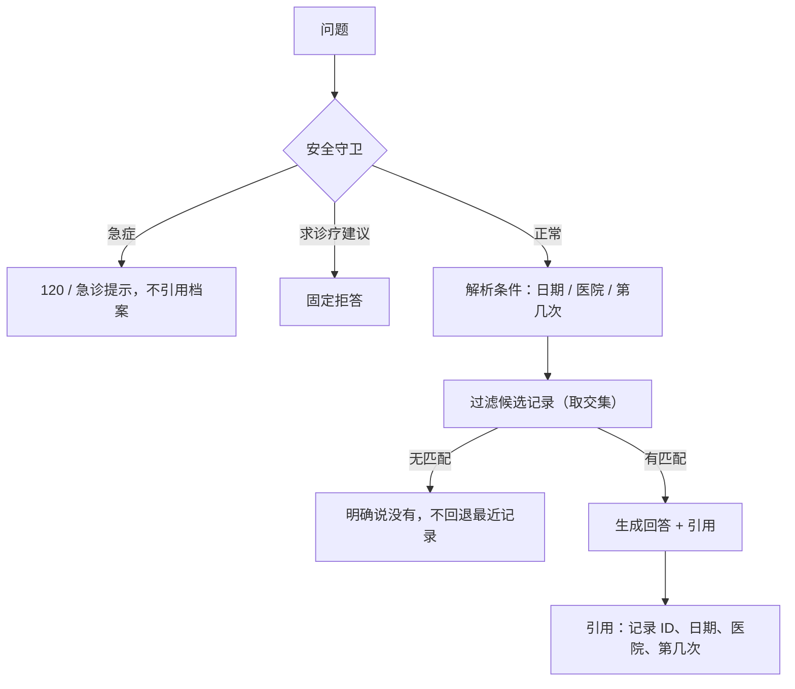

# 架构说明

这份文档说明小鹿由哪些部分组成、数据怎么流动、边界在哪里。改代码前先看这里，能少踩很多坑。

---

## 1. 总览



两种运行形态：

| 形态 | 判定 | 数据位置 | 模型 |
| --- | --- | --- | --- |
| 服务端模式 | `/api/ping` 可达 | 服务端数据库 | 服务端代理 |
| 本机模式 | 探测失败 | 浏览器 localStorage | 不可用，手动录入 |

---

## 2. 前端

`xiaoxiao-ai/app.html` 是**自包含单文件**：HTML、CSS、JS 都在里面，不依赖构建工具。这样部署只需要一个静态文件，也方便非前端同学直接改。

### 视图

| 视图 | 职责 |
| --- | --- |
| `home` | 入口：开始录音、拍照识药、最近记录概览 |
| `work` | 工作台：录音/转写、手动整理、本次记录、对话、用药与概览 |
| `scan` | 拍照识药：选图、识别结果编辑、加入病历 |
| `mine` | 我的：资料、档案时间线、搜索筛选、打印、账号与安全 |

### 关键状态

| 状态 | 说明 |
| --- | --- |
| `state.draft` | 当前未归档草稿 |
| `state.extractState` | `extracting / ready / failed`，决定保存按钮是否可用 |
| `state.extractSeq` | 抽取请求序号，迟到的响应直接丢弃 |
| `state.editedFields` | 用户手工改过的字段，抽取回填时跳过 |
| `state.records` | 当前账号档案 |
| `state.aiOn` | 服务端模型是否可用，由 `/api/ai/status` 决定 |
| `state.saving` | 归档/修改进行中，期间禁止导出 |

### API 层

所有请求走 `apiFetch()`：

- 自动带 `X-Xiaolu-Token`（不用 `Authorization`，部分网关会改写它）
- 自动序列化 JSON、`cache: 'no-store'`
- 统一把后端 `detail` 转成 Error

---

## 3. 后端分层

```
app/
├── api/          # 路由层：只做参数校验、鉴权、调用 repository/agent
│   ├── deps.py          # current_user、限流
│   ├── routes_auth.py   # 注册、登录
│   ├── routes_me.py     # 资料、改密、注销
│   ├── routes_records.py# 记录 CRUD、抽取
│   ├── routes_chat.py   # 问答（含 SSE）
│   ├── routes_ai.py     # 模型代理
│   ├── routes_health.py # ping / healthz / readyz
│   └── routes_ops.py    # ASR、重建索引等
├── agent/        # 业务智能
│   ├── extractor.py     # 文本 → 结构化字段
│   ├── answer.py        # 问题 + 档案 → 回答 + 引用
│   └── llm.py           # 通用模型适配（熔断、重试、用量）
├── core/         # 配置、加密、安全、限流、日志
├── db/           # 模型、仓储、迁移
└── worker/       # 后台任务
```

**硬约束**：路由层不直接写 SQL；所有涉及用户数据的查询必须带 `user_id`，统一放 `db/repo.py`。

---

## 4. 数据流

### 4.1 归档一次就诊



关键规则：

- 抽取没回来之前，保存按钮禁用。
- 用户手工改过的字段，迟到的抽取结果不能覆盖。
- 抽取失败转全手工，不套用本机旧规则。
- `client_id` 唯一，重复提交不会产生两条。

### 4.2 回答一个问题



### 4.3 拍照识药

```
图片 → 前端压缩（长边 1280）→ POST /api/ai/vision
     → 服务端拼提示词 → qwen3-vl-plus
     → JSON 数组 → 前端可编辑药卡 → 加入草稿或最近记录
```

提示词在服务端，剂量优先取包装规格（0.5g），服用粒数不算剂量。

---

## 5. 数据模型

| 表 | 用途 | 关键字段 |
| --- | --- | --- |
| `users` | 账号 | `username` 唯一、`password_hash` |
| `sessions` | 服务端会话 | `token_hash` 主键、`expires_at` |
| `profiles` | 个人资料 | `phone_enc` / `idcard_enc` 密文 |
| `records` | 就诊记录 | `user_id`、`visit_at`、`meds`(JSON)、`conditions`、`discontinued` |
| `runs` / `run_steps` / `tool_calls` | Agent 运行记录 | 按 `run_id` 关联 |
| `jobs` | 持久化任务队列 | `status`、`run_after`、`attempts` |
| `token_usage` | 模型用量 | `user_id`、`model`、tokens |

所有业务表都带 `user_id`；`records` 对 `(user_id, client_id)` 建唯一约束。

---

## 6. 接口一览

| 方法 | 路径 | 说明 |
| --- | --- | --- |
| GET | `/api/ping` | 前端探测后端是否可用 |
| POST | `/api/auth/register` | 注册 |
| POST | `/api/auth/login` | 登录 |
| GET | `/api/me` | 当前用户 |
| GET/PUT | `/api/me/profile` | 资料读取/保存（手机号、身份证解密返回） |
| POST | `/api/me/password` | 改密码，吊销其它会话 |
| DELETE | `/api/me` | 注销，需再次输入密码 |
| GET/POST | `/api/records` | 列表 / 新建 |
| GET/PATCH/DELETE | `/api/records/{id}` | 详情 / 修改 / 删除 |
| POST | `/api/records/extract` | 文本抽取 |
| POST | `/api/chat/sync` | 同步问答 |
| POST | `/api/chat` | 流式问答（SSE） |
| GET | `/api/ai/status` | 模型是否可用、模型名 |
| POST | `/api/ai/chat` | 文本模型代理 |
| POST | `/api/ai/vision` | 识图代理 |
| GET | `/healthz` `/readyz` | 存活 / 就绪 |

鉴权统一用 `X-Xiaolu-Token`。

---

## 7. 安全设计

| 面 | 做法 |
| --- | --- |
| 密码 | pbkdf2 散列，不存明文 |
| 会话 | 随机令牌，库里只存 SHA-256 哈希，可即时吊销 |
| 敏感字段 | 手机号、身份证 Fernet 加密，密钥由 `SECRET_KEY` 派生 |
| 越权 | 跨账号读写一律 404，不泄露资源是否存在 |
| 限流 | 登录/注册/改密/注销共用 auth 额度；问答、识图各自额度 |
| 响应头 | CSP、`X-Frame-Options: DENY`、`Permissions-Policy`、`Referrer-Policy` |
| 缓存 | `/api/*` 强制 `no-store` |
| 密钥 | 只在服务端 `config.env` / `.env`，前端通过代理调用 |

---

## 8. 部署

- 单端口 HTTP 服务，`uvicorn app.main:app --host 0.0.0.0 --port 8000 --proxy-headers`
- 发布目录是 `xiaoxiao-api/dist/`，只含 `app/`、`web/`、`requirements.txt`、`secret.key`、`config.env`
- 启动时自动建表，并用 `ensure_columns()` 给旧库补列
- SQLite 适合单实例；多实例请换 PostgreSQL，迁移脚本在 `alembic/`

---

## 9. 关键取舍

**为什么前端是单文件**
部署简单，评审时一个文件就能看全；代价是文件较大（约 240KB），改动时要小心不要破坏结构。

**为什么用服务端会话而不是 JWT**
部署平台的签名密钥不稳定，JWT 会出现「刚签发就失效」；会话表还能做到「退出即失效」和「改密踢其它设备」。

**为什么默认 SQLite**
零配置启动，方便本地开发和演示；代码与迁移兼容 PostgreSQL，生产可替换。

**为什么模型调用走服务端代理**
Key 不进浏览器，换设备不用重填，也能统一限流和换模型。

**为什么抽取失败不猜**
医疗字段错一个剂量比少填一个字段更危险。宁可让用户手工填，也不要用旧规则凑。

---

## 10. 不做的事

- 不做诊断、处方、用药建议；问答只复述档案
- 不做服药打卡与提醒（产品边界是「档案」）
- 不保存音频，只保留转写文本
- 不把患者数据用于训练
