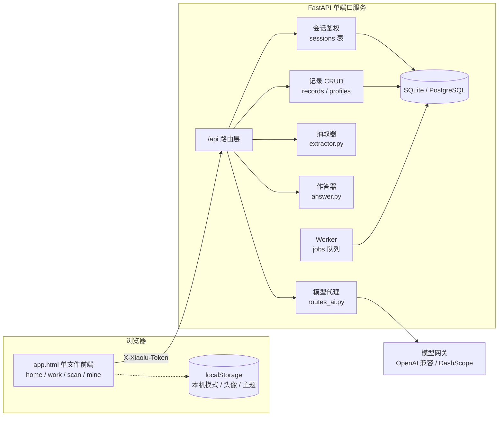
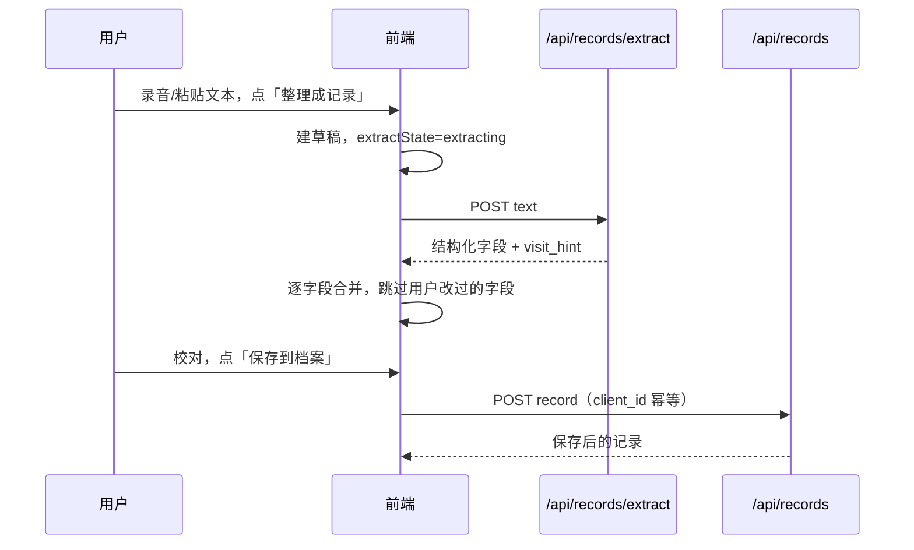
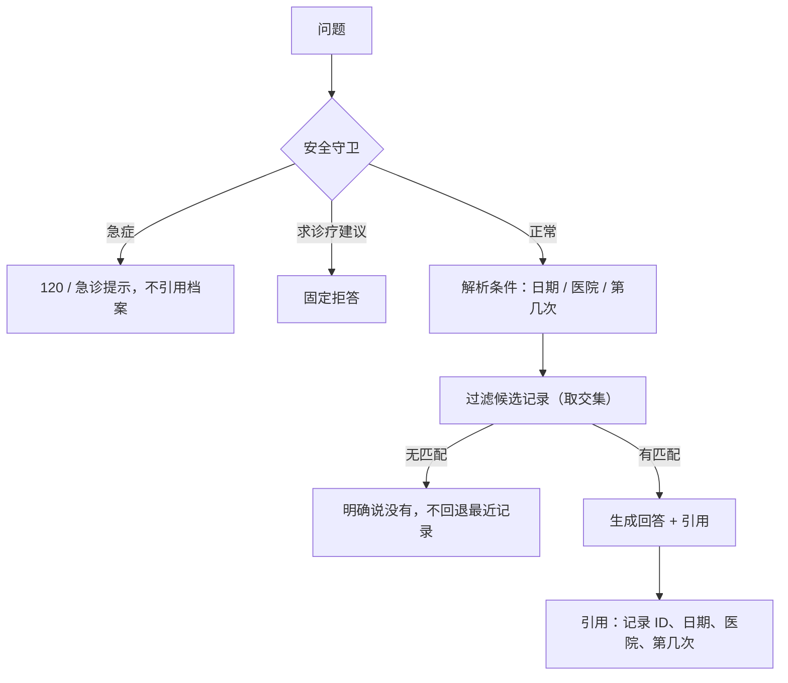

# 架构说明

这份文档说明小鹿由哪些部分组成、数据怎么流动、边界在哪里。改代码前先看这里，能少踩很多坑。

---

## 1. 总览



两种运行形态：

| 形态 | 判定 | 数据位置 | 模型 |
| --- | --- | --- | --- |
| 服务端模式 | `/api/ping` 可达 | 服务端数据库 | 服务端代理 |
| 本机模式 | 探测失败 | 浏览器 localStorage | 不可用，手动录入 |

---

## 2. 前端

`xiaoxiao-ai/app.html` 是**自包含单文件**：HTML、CSS、JS 都在里面，不依赖构建工具。这样部署只需要一个静态文件，也方便非前端同学直接改。

### 视图

| 视图 | 职责 |
| --- | --- |
| `home` | 入口：左「记录」右「询问」两个入口、拍照识药、我的；点顶栏「小鹿」随时回到这里 |
| `work` | 记录：录音/转写、手动整理、本次记录、用药与概览。**不含对话** |
| `ask` | 询问：独立对话页，只按档案回答；顶部返回「记录」 |
| `scan` | 拍照识药：选图、识别结果编辑、加入病历 |
| `mine` | 我的：资料、档案时间线、搜索筛选、打印、账号与安全 |

主模块导航（顶栏 + 手机底部）固定为 **记录 / 询问 / 识药 / 我的**；「首页」不再占导航位，由左上角品牌按钮返回。

### 关键状态

| 状态 | 说明 |
| --- | --- |
| `state.draft` | 当前未归档草稿 |
| `state.extractState` | `extracting / ready / failed`，决定保存按钮是否可用 |
| `state.extractSeq` | 抽取请求序号，迟到的响应直接丢弃 |
| `state.editedFields` | 用户手工改过的字段，抽取回填时跳过 |
| `state.records` | 当前账号档案 |
| `state.aiOn` | 服务端模型是否可用，由 `/api/ai/status` 决定 |
| `state.saving` | 归档/修改进行中，期间禁止导出 |
| `state.calPending` | 刚结束一次录音，归档弹窗关闭后弹「放进日历」 |

### API 层

所有请求走 `apiFetch()`：

- 自动带 `X-Xiaolu-Token`（不用 `Authorization`，部分网关会改写它）
- 自动序列化 JSON、`cache: 'no-store'`
- 统一把后端 `detail` 转成 Error

---

### 主题与提醒

- 主题：`html[data-theme]` 四套（浅白默认 / 暖纸 / 樱粉 / 暗夜），只覆盖颜色令牌，版式不动；弹窗、小鹿插画都用 `--accent` / `--paper-2` 跟随主题。
- 录音结束：归档弹窗关闭后弹小鹿弹窗，把复诊（`follow_up` 解析「两周后」「10月20日」）和用药（药名/剂量/频次/天数）写成 `.ics` 日程，含 `RRULE` 与 `VALARM`；只生成文件，由用户在系统日历里确认导入。
- 提醒设置（用药时间、是否自动生成）按账号存在 `lx_cal_v1_<账号>`。

## 3. 后端分层

```
app/
├── api/          # 路由层：只做参数校验、鉴权、调用 repository/agent
│   ├── deps.py          # current_user、限流
│   ├── routes_auth.py   # 注册、登录
│   ├── routes_me.py     # 资料、改密、注销
│   ├── routes_records.py# 记录 CRUD、抽取
│   ├── routes_chat.py   # 问答（含 SSE）
│   ├── routes_ai.py     # 模型代理
│   ├── routes_health.py # ping / healthz / readyz
│   └── routes_ops.py    # ASR、重建索引等
├── agent/        # 业务智能
│   ├── extractor.py     # 文本 → 结构化字段
│   ├── answer.py        # 问题 + 档案 → 回答 + 引用
│   └── llm.py           # 通用模型适配（熔断、重试、用量）
├── core/         # 配置、加密、安全、限流、日志
├── db/           # 模型、仓储、迁移
└── worker/       # 后台任务
```

**硬约束**：路由层不直接写 SQL；所有涉及用户数据的查询必须带 `user_id`，统一放 `db/repo.py`。

---

## 4. 数据流

### 4.1 归档一次就诊



关键规则：

- 抽取接口先跑规则（谁、哪几个药），再用模型校对药名/剂量；模型的每个字段都要能在原文找到依据，药品数量顺序不一致就整次放弃（`app/agent/refine.py`）。
- 抽取没回来之前，保存按钮禁用。
- 用户手工改过的字段，迟到的抽取结果不能覆盖。
- 抽取失败转全手工，不套用本机旧规则。
- `client_id` 唯一，重复提交不会产生两条。

### 4.2 回答一个问题



作答范围（跨档案 vs 单次）：

- 问「都有什么药 / 都得过什么病 / 都用过什么」：跨全部记录汇总，同名药以最近一次为准，来源可列多条。
- 问「上次 / 最近一次 / 今天」或带日期、医院、第几次：只答那一次，不掺其他记录。
- 没指定范围时：先答最近一次，再把更早记录里出现过的药、诊断、复诊、注意事项补充在后面，避免「只看最近一份」。
- 点名某个药（如「奥美拉唑怎么吃」）：在全部档案里找它最近出现的那次。

### 4.3 拍照识药

```
图片 → 前端压缩（长边 1280）→ POST /api/ai/vision
     → 服务端拼提示词 → qwen3-vl-plus
     → JSON 数组 → 前端可编辑药卡 → 加入草稿或最近记录
```

提示词在服务端，剂量优先取包装规格（0.5g），服用粒数不算剂量。

---

### 老账号迁移（一次性）

改用手机号登录后，历史账号的 `phone_hash` 为空。产品决定：

- 资料里填过**合法且未被占用**手机号的 → 绑定成登录手机号，原密码不变；
- **没有可用手机号**的老账号（含号码被别人占用的）→ 注销，删除账号与全部数据。

实现是 `app/api/routes_admin.py` 里的 `/api/admin/legacy-accounts`：

- 需要服务端配置 `ADMIN_TOKEN` 且请求头带 `X-Admin-Token`，否则返回 404（等于接口不存在）；
- `GET` 只预演（谁绑定、谁删除、哪些号码冲突），`POST` 必须带 `confirm=DELETE` 才执行；
- 删除前把账号、资料、记录导出成 JSON（密文字段原样保留），落盘到 `data/legacy-backup-*.json` 并随响应返回；
- 配套：`GET /api/admin/accounts` 列账号（手机号打码）、`POST /api/admin/accounts/purge`
  按 id 白名单清理、`POST /api/admin/accounts/restore` 从备份恢复、
  `POST /api/admin/accounts/import-records` 把备份里的档案并入现有账号（按 `client_id` 去重）、
  `POST /api/admin/accounts/merge` 两个现有账号合并（记录搬到目标、资料只补空字段、可删来源）、
  `POST /api/admin/accounts/credentials` 合并后把手机号与密码对齐；
- **用完必须清空 `ADMIN_TOKEN` 并重新发布**，接口随之消失。

### 账号与登录

- **登录身份是手机号**，用户名只是显示名，允许重名。两个人可以都叫「张三」，是两个互不可见的账号。
- 手机号不落明文：`phone_hash = HMAC-SHA256(secret_key, 11 位号码)` 建唯一索引用于查找，`phone_enc` 存密文用于回显给本人。换 `secret_key` 会让旧摘要失配，只能重新绑定。
- 老库升级由 `app/db/migrate.py` 完成：补 `phone_hash` / `phone_enc`，**把 `ix_users_username` 从唯一索引改成普通索引**（否则第二个同名账号 500），再给 `phone_hash` 建唯一索引。
- 老账号（`phone_hash IS NULL`）仍可用用户名登录；登录后在「我的 → 账号与安全」绑定手机号，之后两种方式都能进。
- 前端本地缓存按 **账号标识** 分区（服务端 `id:<user.id>`，本机 `p:<手机号>`），不再用用户名，否则同名账号会共用头像、身份证、主题。旧键数据首次登录时一次性迁移（`lx_keys_v2_*` 标记）。

## 5. 数据模型

| 表 | 用途 | 关键字段 |
| --- | --- | --- |
| `users` | 账号 | `phone_hash` 唯一（手机号摘要，登录用）、`phone_enc` 密文、`username` 可重复（显示名）、`password_hash` |
| `sessions` | 服务端会话 | `token_hash` 主键、`expires_at` |
| `profiles` | 个人资料 | `phone_enc` / `idcard_enc` 密文 |
| `records` | 就诊记录 | `user_id`、`visit_at`、`meds`(JSON)、`conditions`、`discontinued` |
| `runs` / `run_steps` / `tool_calls` | Agent 运行记录 | 按 `run_id` 关联 |
| `jobs` | 持久化任务队列 | `status`、`run_after`、`attempts` |
| `token_usage` | 模型用量 | `user_id`、`model`、tokens |

所有业务表都带 `user_id`；`records` 对 `(user_id, client_id)` 建唯一约束。

---

## 6. 接口一览

| 方法 | 路径 | 说明 |
| --- | --- | --- |
| GET | `/api/ping` | 前端探测后端是否可用 |
| POST | `/api/auth/register` | 注册：用户名 + 手机号 + 密码 |
| POST | `/api/auth/login` | 登录：`phone`；老账号可用 `username` |
| GET | `/api/me` | 当前用户 |
| GET/PUT | `/api/me/profile` | 资料读取/保存（手机号只读回显，身份证解密返回） |
| POST | `/api/me/phone` | 绑定 / 更换登录手机号，需验密码 |
| POST | `/api/me/password` | 改密码，吊销其它会话 |
| DELETE | `/api/me` | 注销，需再次输入密码 |
| GET/POST | `/api/records` | 列表 / 新建 |
| GET/PATCH/DELETE | `/api/records/{id}` | 详情 / 修改 / 删除 |
| POST | `/api/records/extract` | 文本抽取 |
| POST | `/api/chat/sync` | 同步问答 |
| POST | `/api/chat` | 流式问答（SSE） |
| GET | `/api/ai/status` | 模型是否可用、模型名 |
| POST | `/api/ai/chat` | 文本模型代理 |
| POST | `/api/ai/vision` | 识图代理 |
| POST | `/api/ai/asr` | 语音转写：data URL 音频 → 文字（qwen omni，单次 ≤ 约 9MB） |
| POST | `/api/ai/asr/speakers` | 说话人分离转写：返回 `segments[{speaker,text,begin,end}]`，按「医生 / 患者」分行 |
| GET | `/healthz` `/readyz` | 存活 / 就绪 |

鉴权统一用 `X-Xiaolu-Token`。

**录音转写链路**：`/api/ai/asr/speakers` 把音频传到 DashScope 临时存储，提交非实时转写任务
（`qwen-audio-3.0-asr-flash-filetrans`，`diarization_enabled=true`、`speaker_count=2`），
轮询拿到带 `speaker_id` 的句子；再用文本模型判断哪位是医生，失败时退回关键词规则
（开药/检查/复诊 vs 描述症状/以「医生」开头）。相邻同角色的句子会合并成一段。
模型不可用或超时，前端自动退回 `/api/ai/asr` 普通转写；两边都失败才用浏览器实时结果。

---

## 7. 安全设计

| 面 | 做法 |
| --- | --- |
| 密码 | pbkdf2 散列，不存明文 |
| 会话 | 随机令牌，库里只存 SHA-256 哈希，可即时吊销 |
| 敏感字段 | 手机号、身份证 Fernet 加密，密钥由 `SECRET_KEY` 派生 |
| 越权 | 跨账号读写一律 404，不泄露资源是否存在 |
| 限流 | 登录/注册/改密/注销共用 auth 额度；问答、识图各自额度 |
| 响应头 | CSP、`X-Frame-Options: DENY`、`Permissions-Policy`、`Referrer-Policy` |
| 缓存 | `/api/*` 强制 `no-store` |
| 密钥 | 只在服务端 `config.env` / `.env`，前端通过代理调用 |

---

## 8. 部署

- 单端口 HTTP 服务，`uvicorn app.main:app --host 0.0.0.0 --port 8000 --proxy-headers`
- 发布目录是 `xiaoxiao-api/dist/`，只含 `app/`、`web/`、`requirements.txt`、`secret.key`、`config.env`
- 启动时自动建表，并用 `ensure_columns()` 给旧库补列
- SQLite 适合单实例；多实例请换 PostgreSQL，迁移脚本在 `alembic/`

---

## 9. 关键取舍

**为什么前端是单文件**
部署简单，评审时一个文件就能看全；代价是文件较大（约 240KB），改动时要小心不要破坏结构。

**为什么用服务端会话而不是 JWT**
部署平台的签名密钥不稳定，JWT 会出现「刚签发就失效」；会话表还能做到「退出即失效」和「改密踢其它设备」。

**为什么默认 SQLite**
零配置启动，方便本地开发和演示；代码与迁移兼容 PostgreSQL，生产可替换。

**为什么模型调用走服务端代理**
Key 不进浏览器，换设备不用重填，也能统一限流和换模型。

**为什么抽取失败不猜**
医疗字段错一个剂量比少填一个字段更危险。宁可让用户手工填，也不要用旧规则凑。

---

## 10. 不做的事

- 不做诊断、处方、用药建议；问答只复述档案
- 不做服药依从性记录：提醒只在本机（页内提示 / 系统通知 / 导出 .ics），
  勾掉「这一顿不再提醒」只是本地提醒状态，不上传、不参与问答，问答里仍答「没有服药记录」
- 服务端不长期保存音频：转写时音频经 DashScope 临时存储（48 小时自动清理），只把转写文本写进档案
- 不把患者数据用于训练
